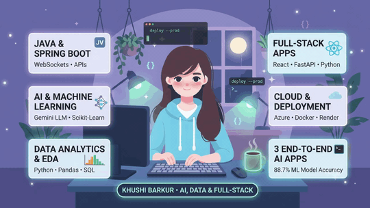

  

# 💫 About Me:
👩‍💻 **I’m currently working on**   Building AI-powered data analytics tools, machine learning applications, and Java Spring Boot backends.  🤝 **I’m looking to collaborate on**   AI/ML projects, data analytics solutions, and full-stack applications using Python, Java, React, and FastAPI.  🛠️ **I’m looking for help with**   Improving ML model performance, designing scalable backend systems, and deploying AI applications for real-world use cases.  🌱 **I’m currently learning**   Cloud architecture, production-ready AI applications, and data-driven product development.  💬 **Ask me about**   Java, Spring Boot, Python, SQL, Exploratory Data Analysis (EDA), machine learning, and building AI-powered applications.  ⚡ **Fun fact**   I helped lead NSS outreach and blood donation campaigns at IET DAVV that collected **245 units of blood over two years**.

## 🌐 Socials:
  

# 💻 Tech Stack:
                                    
# 📊 GitHub Stats:
 
 

---

<!-- Proudly created with GPRM ( https://gprm.itsvg.in ) -->
