<!-- ===================== HEADER ===================== -->

  

  

  

  
  
  

---

## 💫 About Me

I'm interested in building useful products at the intersection of **AI, data analytics, and backend development**.

- 🔭 **Currently working on:** AI-powered data analytics tools, machine learning applications, and Java Spring Boot backends.
- 🤝 **Open to collaborating on:** AI/ML projects, analytics solutions, and full-stack applications using Python, Java, React, and FastAPI.
- 🌱 **Currently learning:** Cloud architecture, production-ready AI applications, and data-driven product development.
- 🧠 **Ask me about:** Java, Spring Boot, Python, SQL, exploratory data analysis (EDA), machine learning, and AI-powered applications.
- 🛠️ **Improving:** ML model performance, scalable backend design, and real-world AI deployment.
- ⚡ **Beyond tech:** I helped lead NSS outreach and blood donation campaigns at IET DAVV, contributing to a drive that collected **245 units of blood over two years**.

## 🧰 Tech Stack

**Languages**

**Backend & Web**

**Data, Analytics & Databases**

**Cloud & Tools**

## 📊 GitHub Stats

  
  

  

  

